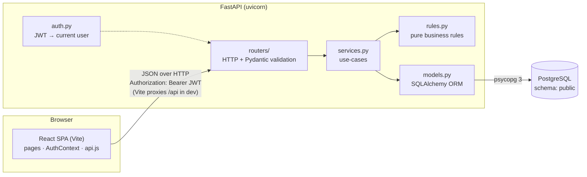
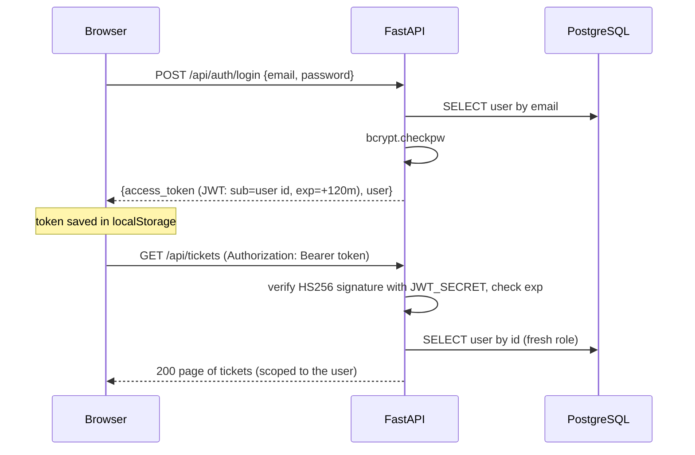

# Architecture Overview

## The three tiers



| Tier | Responsibility |
|---|---|
| **React SPA** | Four screens. Keeps the JWT and current user in `AuthContext`. `api.js` adds the token and turns error bodies into `ApiError`. It hides actions the user can't take, **but enforces nothing**. |
| **FastAPI** | Authenticates every request, validates input with Pydantic, applies the business rules, and talks to the DB. It is stateless: any instance can serve any request, because identity comes from the signed JWT. |
| **PostgreSQL** | Source of truth. Constraints (FKs, CHECKs, unique email) are the last line of defence. Row-level locking during `UPDATE` makes optimistic locking safe under concurrency. |

## Backend layers

Each layer has a single job, so each one is easy to read, test and change:

| Layer | File(s) | Knows about | Doesn't know about |
|---|---|---|---|
| Routers | `app/routers/*.py` | HTTP, Pydantic schemas | SQL, rules |
| Auth | `app/auth.py` | bcrypt, JWT, current user | business rules |
| Services | `app/services.py` | DB session, models, rules | HTTP status codes |
| Rules | `app/rules.py` | `User`, `Ticket`, `Status` objects | DB, HTTP |
| Models | `app/models.py` | tables, constraints, `version` lock | everything above |
| Error mapping | `app/main.py` | domain error → HTTP status | — |

The **rules layer is pure** (no I/O). That's why `tests/test_rules.py` can check the whole transition matrix without a database, and why "where is rule X enforced?" always has a one-file answer.

## Request lifecycle: resolving a ticket

```
Browser: POST /api/tickets/7/status  {"status":"resolved","version":3}
  │      Authorization: Bearer eyJ...
  ▼
FastAPI
  ├─ Pydantic: body is a valid StatusChangeRequest?                  no → 422
  ├─ auth.get_current_user: signature + expiry OK, user exists?      no → 401
  ├─ services.change_status
  │    ├─ load ticket 7
  │    ├─ rules.ensure_can_view       (agent, or creator)             no → 404
  │    ├─ rules.ensure_can_change_status (agent; assignee if resolve) no → 403
  │    ├─ rules.ensure_version_matches (3 == current?)               no → 409
  │    ├─ rules.validate_transition   (in_progress → resolved?)      no → 400
  │    ├─ add TicketStatusChange row; set status
  │    └─ COMMIT: UPDATE tickets ... WHERE id=7 AND version=3  0 rows → 409
  └─ 200 TicketDetail (version 4)
  ▼
Browser: replace ticket state, show "Status changed to Resolved."
         on 409: show "changed by someone else, reload" banner
```

## Authentication flow



## Frontend structure

| Piece | Role |
|---|---|
| `main.jsx` | Routes: `/login` is public; `/`, `/tickets/new` and `/tickets/:id` sit inside `ProtectedLayout` |
| `components/Layout.jsx` | The auth guard: shows a spinner while the saved token is checked, redirects to `/login` with no session |
| `auth/AuthContext.jsx` | `user`, `isAgent`, `login()`, `logout()`. Any 401 from the API ends the session (marked as *expired*) |
| `api.js` | One function per endpoint; adds the JWT; raises `ApiError {status, code, fieldErrors}` |
| `pages/*` | One file per screen. Each handles its own loading, error and empty states |
| `lib/tickets.js` | Labels, `LIMITS` (mirrors Pydantic) and `NEXT_STATUSES` (mirrors `rules.py`), used only to decide what to show |

**State** lives in plain React `useState` per page, plus `AuthContext` for the session. Dashboard filters live in the **URL query string**. The app has no global store; it doesn't need one.

## Local development topology

```
http://localhost:5173  (Vite dev server)
   ├─ /src/*      → React app with hot reload
   └─ /api/*      → proxied to http://127.0.0.1:8000 (uvicorn)
                        └─ PostgreSQL localhost:5432 / "Yalla & co"
                              ├─ schema public  (app data)
                              └─ schema test    (pytest only, created and dropped per run)
```

The backend also allows `localhost:5173` through CORS, so the UI could call it directly without the proxy.
