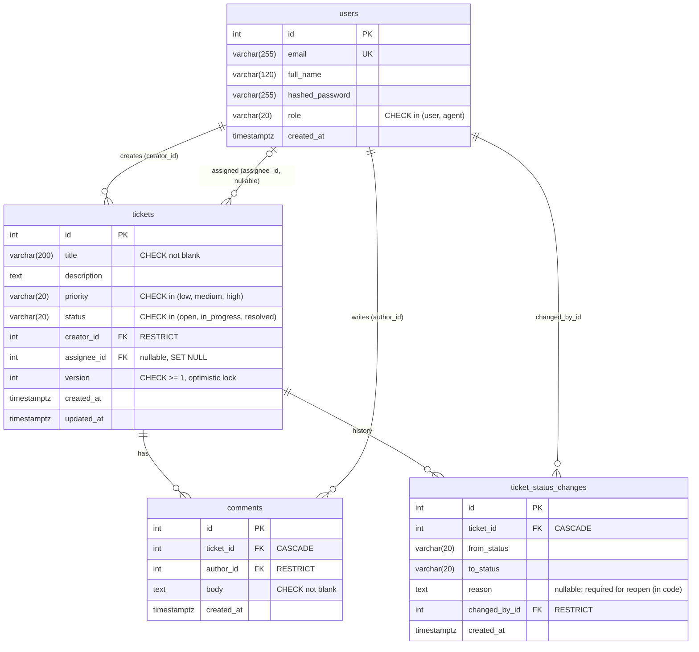

# Database Design

PostgreSQL. The schema is defined in [`backend/app/models.py`](../backend/app/models.py) and created by the Alembic migration in [`backend/alembic/versions/`](../backend/alembic/versions/).

## Entity-relationship diagram



## Entities

| Table | Purpose |
|---|---|
| **users** | Everyone who can log in. `role` decides what they can do. Passwords are stored only as bcrypt hashes. |
| **tickets** | One support request. Holds the fields required by the brief, plus `version` for conflict detection and `updated_at`. |
| **comments** | The discussion thread on a ticket. Append-only. |
| **ticket_status_changes** | An audit row for every status move: who, when, from and to, and **why** (the reopen reason). The ticket detail page shows it as a timeline. |

## Relationships

| Relationship | Cardinality | On delete of the parent | Why |
|---|---|---|---|
| `tickets.creator_id → users` | many tickets per user | **RESTRICT** | You can't delete a user and orphan their tickets. |
| `tickets.assignee_id → users` | many tickets per agent, optional | **SET NULL** | If an agent is removed, their tickets become *unassigned* rather than disappearing. |
| `comments.ticket_id → tickets` | many per ticket | **CASCADE** | A comment means nothing without its ticket. |
| `comments.author_id → users` | many per user | **RESTRICT** | Keeps who-said-what intact. |
| `ticket_status_changes.ticket_id → tickets` | many per ticket | **CASCADE** | History belongs to its ticket. |
| `ticket_status_changes.changed_by_id → users` | many per user | **RESTRICT** | The audit trail must keep pointing to a real person. |

## Constraints

| Constraint | Where | Enforces |
|---|---|---|
| `users.email` UNIQUE (index `ix_users_email`) | DB | One account per email. Login lower-cases the address. |
| `user_role`, `ticket_priority`, `ticket_status`, … CHECKs | DB | Enum columns only accept known values. |
| `title_not_blank`: `length(btrim(title)) > 0` | DB | No whitespace-only titles, even if a bug bypasses the API. |
| `comment_not_blank` | DB | The same for comment bodies. |
| `version_positive`: `version >= 1` | DB | Sanity check on the lock column. |
| NOT NULL on every required column | DB | Required fields can't be missing. |
| Title 3–200, description 1–5000, comment 1–2000, reason ≤ 1000 (after trimming) | API (Pydantic) | Readable, per-field 422 errors. |
| Assignee must have role `agent` | Code (`rules.ensure_can_assign`) | A foreign key can't check a column on the row it points to. |
| Reopen requires a reason | Code (`rules.validate_transition`) | The rule depends on the transition, not on a single column. |

**Enums are stored as `VARCHAR(20)` with a `CHECK` constraint** rather than native Postgres `ENUM` types. They are just as strict, but adding a value later is a simple migration instead of `ALTER TYPE … ADD VALUE`, which has transaction restrictions.

## Indexes

| Index | Serves |
|---|---|
| `tickets(creator_id)` | A user's own list (`WHERE creator_id = me`), the most common query |
| `tickets(assignee_id)` | Agent filters "assigned to me" and "unassigned" |
| `tickets(status)` | Status filter |
| `tickets(created_at)` | Default sort, newest first |
| `comments(ticket_id)`, `ticket_status_changes(ticket_id)` | Loading a ticket's detail page |
| `users(email)` unique | Login lookup |

Postgres doesn't index foreign keys automatically, so these are declared explicitly.

## The `version` column (optimistic locking)

```
tickets.version  INT NOT NULL  CHECK (version >= 1)
```

- Starts at 1. SQLAlchemy (`version_id_col`) **increments it on every UPDATE** of the ticket.
- Every UPDATE is issued as `UPDATE tickets SET …, version = N+1 WHERE id = :id AND version = N`. If another transaction already moved it to N+1, zero rows match and the write is refused (→ HTTP 409).
- The API returns `version` with every ticket, and the client must send it back on every edit. That catches stale browser tabs as well as true races.
- Adding a comment does **not** bump the version. Comments are new rows, so they can't overwrite anything.

## Timestamps

All timestamps are `timestamptz`, with defaults set by the server (`now()`). `updated_at` changes on every ticket UPDATE and is returned via `RETURNING`, so no extra query is needed.
