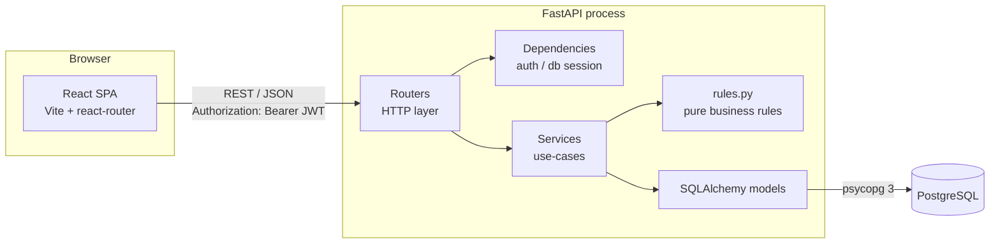

# Phase 1: Architecture and Scaffolding

**Goal:** set up the shape of the system before writing any features, so every later phase has an obvious home.

## 1. System overview



| Layer | Responsibility | Never does |
|---|---|---|
| **React SPA** | Screens, form validation (UX only), shows or hides controls by role | Enforce security. The server re-checks everything |
| **Routers** (`app/routers/`) | Parse the HTTP request and validate it with Pydantic, call a service, shape the response | Contain business logic |
| **Auth / dependencies** (`app/auth.py`, `app/db.py`) | Resolve the current user from the JWT; hand out a DB session per request | — |
| **Services** (`app/services.py`) | Orchestrate one use-case: load rows, call rules, write, commit | Know about HTTP |
| **Rules** (`app/rules.py`) | Pure functions: is this transition allowed? can this user resolve? | Touch the DB, so they are easy to unit test |
| **Models** (`app/models.py`) | Tables, relationships, constraints, the `version` column | — |
| **PostgreSQL** | Source of truth; constraints are the last line of defence | — |

## 2. Request lifecycle (example: resolve a ticket)

```
POST /api/tickets/42/status   {status:"resolved", version:3}
  │
  ├─ Pydantic validates the body                         → 422 on bad input
  ├─ auth.get_current_user decodes the JWT               → 401 if missing or invalid
  ├─ services.change_status(db, user, 42, body)
  │     ├─ load ticket; hide if user may not view it     → 404
  │     ├─ rules.can_change_status(user, ticket, target) → 403 (e.g. not the assignee)
  │     ├─ rules.validate_transition(cur, target, reason)→ 400 (e.g. open → resolved)
  │     ├─ compare body.version with ticket.version      → 409 stale client
  │     ├─ apply change and write a status-history row
  │     └─ commit: UPDATE … WHERE id=42 AND version=3    → 409 if a concurrent write won
  └─ 200 with the updated ticket (version 4)
```

Domain exceptions (`NotFound`, `PermissionDenied`, `TransitionError`, `VersionConflict`) are raised in services and rules. One handler in `main.py` turns each into an HTTP status with a consistent body `{"detail": ..., "code": ...}`.

## 3. Where each business rule lives

| Rule from the brief | Enforced in | Tested in (Phase 4) |
|---|---|---|
| Open → In Progress → Resolved | `rules.ALLOWED_TRANSITIONS` + `validate_transition` | `test_rules.py`, `test_status_transitions.py` |
| Reopen only with a reason | `rules.validate_transition` | same |
| Only the assigned agent resolves | `rules.can_change_status` | `test_resolve_permission.py` |
| Users can't see others' tickets | `rules.can_view_ticket` + list query scoped to `creator_id` | `test_auth_privacy.py` |
| No silent overwrites | `version` column (SQLAlchemy `version_id_col`) + explicit version check | `test_concurrency.py` |

## 4. Folder layout

```
backend/
  app/
    main.py        FastAPI app, CORS, routers, exception handlers
    config.py      Settings from .env (pydantic-settings)
    db.py          Engine, SessionLocal, get_db dependency
    models.py      (phase 2)
    rules.py       (phase 2)
    schemas.py     (phase 3)
    auth.py        (phases 2-3) bcrypt + JWT + get_current_user
    services.py    (phase 3)
    routers/       (phase 3)
  alembic/         (phase 2) migrations
  scripts/seed.py  (phase 2)
  tests/           (phase 4)
frontend/          (phase 5)
docs/
```

## 5. What was built in this phase

- `backend/requirements.txt`: pinned dependencies
- `backend/app/config.py`: typed settings loaded from `backend/.env`
- `backend/app/db.py`: SQLAlchemy 2.0 engine, session factory, `Base`, `get_db` dependency
- `backend/app/main.py`: app factory, CORS, `GET /api/health` (runs `SELECT 1` against the DB)
- `backend/.env.example`: copy it to `.env`; secrets are never committed
- `.gitignore` and `git init`

## 6. Run it

```powershell
cd backend
python -m venv .venv
.\.venv\Scripts\Activate.ps1
pip install -r requirements.txt
copy .env.example .env        # then edit DATABASE_URL with your postgres password
uvicorn app.main:app --reload
# open http://127.0.0.1:8000/api/health  → {"status":"ok","database":"ok"}
```

The app uses a single database, **`Yalla & co`**, created in pgAdmin:
- The app's tables live in the `public` schema.
- Tests use a separate `test` schema in the same database. `TEST_DATABASE_URL` sets `search_path=test`, so test runs never touch real data.
- In `.env`, write the database name exactly as it appears in pgAdmin. It is case-sensitive and must not be percent-encoded, because SQLAlchemy does not decode the database part of the URL. Only special characters in the **password** need encoding.

## 7. Decisions made in this phase

- **FastAPI over Django.** The brief's hardest parts are explicit rules and validation. FastAPI + Pydantic makes request contracts visible in code, and its dependency injection (`Depends`) is a clean place for auth. Django would bring an admin and an ORM we don't need, and its permission system is less explicit for these custom rules.
- **Synchronous SQLAlchemy.** Simpler to read, test and explain than async. The load here doesn't need async DB I/O.
- **psycopg 3** as the driver: the maintained successor to psycopg2.
- **Settings through pydantic-settings**, so a missing or mistyped env var fails at startup rather than at the first request.
