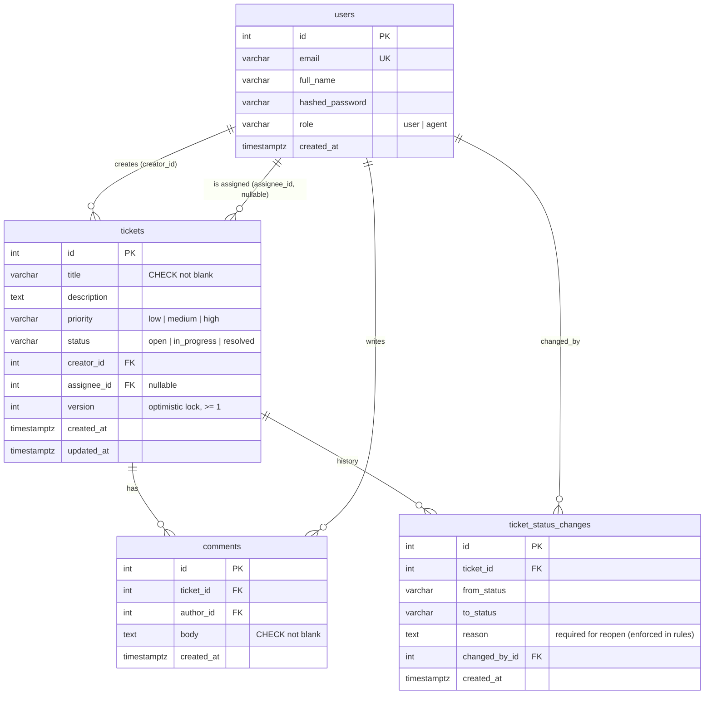

# Phase 2: Models, Migrations and Business Rules

**Goal:** define the data and the rules before building any HTTP endpoints. Everything in this phase works without FastAPI running.

## 1. Files

| File | What it holds |
|---|---|
| `backend/app/models.py` | 4 SQLAlchemy tables, 3 enums, constraints, indexes, the `version` lock column |
| `backend/app/rules.py` | Pure business-rule functions + domain exceptions |
| `backend/app/auth.py` | bcrypt `hash_password` / `verify_password` (JWT added in Phase 3) |
| `backend/alembic/env.py` | Migrations read `DATABASE_URL` from `.env` and the metadata from `models.py` |
| `backend/alembic/versions/8a59d62bb307_initial_schema.py` | The initial migration (autogenerated, then reviewed) |
| `backend/scripts/seed.py` | Demo users + tickets, idempotent |

## 2. Schema



### Design choices

| Choice | Why |
|---|---|
| **Enums stored as VARCHAR + CHECK** (`native_enum=False`) | Just as strict as a Postgres `ENUM` type, but adding a value later is a simple migration rather than `ALTER TYPE`. |
| **`ON DELETE RESTRICT`** for creator/author/changed_by | History must not silently vanish. You can't delete a user who still owns tickets or comments. |
| **`ON DELETE SET NULL`** for `assignee_id` | If an agent leaves, their tickets become unassigned rather than deleted. |
| **`ON DELETE CASCADE`** for comments and history | They have no meaning without their ticket. |
| **`ticket_status_changes` table** | The brief requires a reason to reopen. Storing it in an audit table means we keep *every* reason, not just the latest, and the details page can show a timeline. |
| **Indexes** on `creator_id`, `assignee_id`, `status`, `created_at` | These match the dashboard queries: "my tickets", "assigned to me", "filter by status", "newest first". |
| **`timestamptz`** everywhere | Timestamps are absolute instants, so there's no timezone ambiguity between server and browser. |
| **"Assignee must be an agent" lives in code, not the DB** | A foreign key can't check a column on the row it points to. It's enforced in `rules.ensure_can_assign`. |

## 3. Business rules (`rules.py`)

All rules are pure functions: they take a `User` / `Ticket` / `Status` and either return normally or raise an exception. They never query the DB, so they're simple to read and to unit test.

```python
ALLOWED_TRANSITIONS = {
    OPEN:        {IN_PROGRESS},
    IN_PROGRESS: {RESOLVED},
    RESOLVED:    {IN_PROGRESS},   # reopen, and only with a reason
}
```

| Function | Rule | Raises → HTTP (Phase 3) |
|---|---|---|
| `validate_transition` | Only the moves above; reopen needs a non-blank reason | `RuleViolation` → 400 |
| `ensure_can_view` | Agents see all; users only their own | `NotFound` → **404** (we don't reveal that the ticket exists) |
| `ensure_can_create_ticket` | Only users file tickets | `PermissionDenied` → 403 |
| `ensure_can_comment` | Anyone who can view the ticket | `NotFound` → 404 |
| `ensure_can_change_status` | Agents only; **resolve requires `assignee_id == me`** | `PermissionDenied` → 403 |
| `ensure_can_assign` | Agents only; the assignee must be an agent | 403 / 400 |
| `ensure_version_matches` | The client's `version` must equal the DB's | `VersionConflict` → 409 |

**Check order** (in the services, Phase 3): view (404) → permission (403) → version (409) → transition (400). The version check comes before the transition check because a stale client may only *think* a move is illegal. After a reload, the ticket's real status may make it legal.

## 4. Concurrent updates: two layers of protection

1. **Stale client** (`rules.ensure_version_matches`). Every edit request carries the `version` the browser loaded. If the DB's version is newer, someone changed the ticket in between, so the request is rejected with 409 and the user reloads.
2. **Race inside the server** (`__mapper_args__ = {"version_id_col": version}`). Two requests could both pass check 1 at the same moment. SQLAlchemy therefore writes every update as

   ```sql
   UPDATE tickets SET ..., version = 2 WHERE id = 7 AND version = 1
   ```

   The second request's UPDATE matches 0 rows, and SQLAlchemy raises `StaleDataError` instead of overwriting. Phase 3 maps that to 409 as well.

**Why optimistic locking rather than `SELECT … FOR UPDATE`?** Support tickets are rarely edited at the same moment, so conflicts are rare. Optimistic locking holds no locks while a person reads the page, and it can catch stale browser tabs, which a row lock can't, because a lock only lives as long as one transaction.

## 5. Verified

```
alembic upgrade head          → 4 tables + indexes created in "Yalla & co" (schema public)
python -m scripts.seed        → 4 users, 3 tickets (open / in_progress / resolved)
python -m scripts.seed again  → "already present - nothing to do"
```

Smoke check against the real DB (all writes undone afterwards; one side effect: ticket 2's `version` is now 3, because the lock test updated it and then restored the original value):
- open→in_progress OK · open→resolved rejected · reopen with a blank reason rejected · reopen with a reason OK
- Bob viewing Alice's ticket → `NotFound` · Priya resolving Sam's ticket → `PermissionDenied` · Sam resolving → OK · a user changing status → `PermissionDenied` · assigning to a non-agent → `RuleViolation`
- Blank title → DB rejects it via `title_not_blank`
- Two sessions update the same ticket → the second gets `StaleDataError` (0 rows matched)

## 6. Demo accounts (DEMO ONLY)

| Email | Role | Password |
|---|---|---|
| alice@example.com | user | Password123! |
| bob@example.com | user | Password123! |
| agent.sam@example.com | agent | Password123! |
| agent.priya@example.com | agent | Password123! |

## 7. Commands

```powershell
cd backend
.\.venv\Scripts\Activate.ps1
alembic upgrade head                          # create/upgrade tables
python -m scripts.seed                        # demo data
alembic revision --autogenerate -m "msg"      # after changing models.py
alembic downgrade -1                          # undo the last migration
```

## 8. Assumptions introduced here

- Only users create tickets; agents work them.
- Only agents change status or assignment. Users can't reopen; they comment instead.
- Moving Open → In Progress doesn't require an assignee, but only the assignee can resolve, so in practice a ticket must be assigned before it can be resolved.
